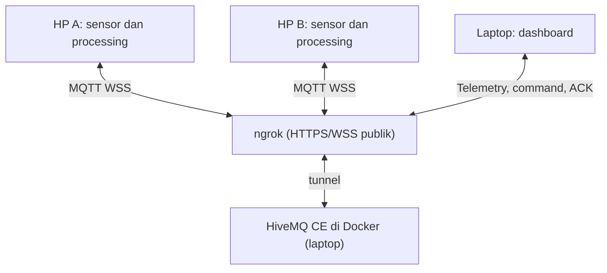

# SigHeat — Peta kualitas koneksi

**SigHeat (Signal Heatmap)** adalah proyek IoT kelompok untuk membandingkan koneksi pada titik pengamatan: **dua HP sebagai edge**, **accelerometer + gyroscope**, **RMS dan integrasi rotasi**, **MQTT cloud**, serta **dashboard di laptop**. Kedua HP dapat memakai browser tanpa instalasi tambahan atau Termux + Python pada Android.

SigHeat mengukur waktu perjalanan pesan aplikasi **HP → broker → HP**, variasi latency, dan keberhasilan probe. Hasilnya bukan kekuatan radio dBm, ping ICMP, atau kecepatan unduh. Lokasi opsional membantu menempatkan pengamatan pada peta.

## Anggota Kelompok

1. [Addia Fa'adihilah Mahendra Nugraha] — [24060125120006]
2. [Farrel Athaya Firdaus] — [24060125120009]
3. [Masirotuzzaman Fatwa Gemintang] — [24060125120001]

## Cara kerja



> Diagram di atas adalah konfigurasi yang dipakai kelompok kami: **broker HiveMQ pribadi** (Docker di laptop) yang dipublikasikan dengan **ngrok**. Untuk broker publik/cloud biasa, ganti blok "ngrok + HiveMQ CE" dengan satu broker cloud (lihat bagian 0, Opsi 1).

Setiap HP membaca dua sensor, menghitung hasil dalam window, dan melakukan probe ke broker. Dashboard menerima telemetri serta mengirim **Ukur sekarang** atau **Ubah interval** ke HP terpilih. HP membalas ACK; hasil pengukuran diperiksa pada telemetri berikutnya.

MQTT adalah protokol; HiveMQ/EMQX adalah broker; JSON adalah format payload. ID perangkat harus berbeda, sedangkan ID proyek dan alamat broker harus sama.

## 0. Siapkan broker MQTT

Semua perangkat (dashboard + kedua HP) harus memakai **alamat broker WSS yang sama**. Pilih salah satu:

- **Opsi 1 — Broker publik/cloud:** misalnya `wss://broker.hivemq.com:8884/mqtt`. Praktis untuk latihan, tetapi publik (lihat catatan keamanan di bagian 1).
- **Opsi 2 — HiveMQ pribadi: Docker + ngrok (dipakai kelompok kami):** broker dijalankan sendiri di laptop dengan Docker, lalu `localhost` dipublikasikan ke internet melalui ngrok sehingga HP dapat terhubung lewat **WSS**.

### Opsi 2: HiveMQ Community Edition di Docker + ngrok

**Mengapa perlu ngrok?** Broker di Docker hanya dapat diakses sebagai `localhost` di laptop. HP (terutama Opsi A, browser dari halaman HTTPS) memerlukan alamat **`wss://`** yang bisa dijangkau dari luar. ngrok memberi URL HTTPS publik yang meneruskan lalu lintas (termasuk WebSocket) ke port di laptop, lengkap dengan sertifikat TLS.

**Prasyarat:** Docker (Desktop atau Engine) dan akun ngrok gratis dengan *authtoken*.

#### Langkah 1 — Siapkan konfigurasi WebSocket HiveMQ

Secara bawaan HiveMQ CE hanya membuka MQTT TCP (1883). Aktifkan *WebSocket listener* agar browser/Termux dapat terhubung. Buat berkas `conf/config.xml` di folder kerja:

```xml
<?xml version="1.0"?>
<hivemq>
  <listeners>
    <tcp-listener>
      <port>1883</port>
      <bind-address>0.0.0.0</bind-address>
    </tcp-listener>
    <websocket-listener>
      <port>8000</port>
      <bind-address>0.0.0.0</bind-address>
      <path>/mqtt</path>
      <name>websocket-listener</name>
      <subprotocols>
        <subprotocol>mqttv3.1</subprotocol>
        <subprotocol>mqtt</subprotocol>
      </subprotocols>
      <allow-extensions>true</allow-extensions>
    </websocket-listener>
  </listeners>
</hivemq>
```

#### Langkah 2 — Jalankan HiveMQ di Docker

```bash
docker run -d --name hivemq \
  -p 1883:1883 -p 8083:8000 \
  -v "$(pwd)/conf/config.xml:/opt/hivemq/conf/config.xml" \
  hivemq/hivemq-ce
```

> **Penting:** port WebSocket HiveMQ (di dalam container `8000`) dipetakan ke port **`8083`** di laptop, bukan `8000`, karena `python server.py --port 8000` untuk dashboard sudah memakai port 8000. Jika dipetakan sama, akan terjadi bentrok port.

Periksa bahwa broker berjalan:

```bash
docker logs hivemq | grep -i "websocket"
```

Log harus menunjukkan *Started WebSocket Listener* pada port 8000 dengan path `/mqtt`.

Alternatif dengan `docker-compose.yml`:

```yaml
services:
  hivemq:
    image: hivemq/hivemq-ce
    container_name: hivemq
    restart: unless-stopped
    ports:
      - "1883:1883"
      - "8083:8000"
    volumes:
      - ./conf/config.xml:/opt/hivemq/conf/config.xml
```

Jalankan dengan `docker compose up -d`.

#### Langkah 3 — Publikasikan dengan ngrok

Daftarkan token (sekali saja), lalu buka tunnel ke port WebSocket **8083**:

```bash
ngrok config add-authtoken <TOKEN_NGROK_ANDA>
ngrok http 8083
```

ngrok menampilkan alamat *Forwarding*, misalnya:

```text
Forwarding   https://abcd-1234.ngrok-free.app -> http://localhost:8083
```

Ubah menjadi alamat broker dengan mengganti `https://` menjadi **`wss://`**, menghilangkan port, dan menambahkan path `/mqtt`:

```text
wss://abcd-1234.ngrok-free.app/mqtt
```

Itulah nilai **Broker WSS** untuk dashboard dan kedua HP. Jangan memakai port 8884/8083 pada URL ngrok; ngrok sudah melayani lewat port 443 standar.

#### Langkah 4 — Pakai alamat tersebut di semua perangkat

| Perangkat | Tempat mengisi | Nilai |
|---|---|---|
| Dashboard | Hubungkan → **Broker WSS** | `wss://abcd-1234.ngrok-free.app/mqtt` |
| HP A / HP B (browser) | Isian **Broker** di `index.html` | sama |
| HP A / HP B (Termux) | `MQTT_WSS_URL` di `.env` | sama |
| Semua | **Project ID** | sama, misalnya `sigheat_kelompok_07_uji1` |
| Semua | **ID perangkat** | berbeda: `hp-a`, `hp-b` |

Contoh `.env` untuk Termux:

```dotenv
PROJECT_ID=sigheat_kelompok_07_uji1
MQTT_WSS_URL=wss://abcd-1234.ngrok-free.app/mqtt
MQTT_USERNAME=
MQTT_PASSWORD=
INTERVAL_S=5
```

#### Catatan dan pemecahan masalah (Docker + ngrok)

- **URL ngrok gratis berubah setiap tunnel dimulai ulang.** Setelah restart ngrok, perbarui Broker WSS di dashboard, kedua HP, dan `.env` Termux. Domain statis tersedia di akun ngrok bila ingin alamat tetap.
- **Laptop harus tetap menyala** dengan Docker (container `hivemq`) dan ngrok berjalan selama pengukuran. Jika laptop tidur atau ngrok berhenti, kedua HP akan terputus dan data dianggap tidak real-time.
- **Latency termasuk jalur ngrok.** Rute HP → ngrok → laptop → ngrok → HP menambah waktu perjalanan dibanding broker cloud langsung. Gunakan broker dan jalur yang sama untuk semua titik agar perbandingan tetap adil, dan catat konfigurasi ini dalam laporan.
- **Dengan ngrok, laptop dan HP tidak wajib satu Wi-Fi** untuk jalur broker, karena HP mengakses internet publik. Dashboard lokal (`localhost:8000`) tetap berjalan di laptop, dan HP pengukur Opsi A tetap memerlukan halaman HTTPS.
- **Keamanan:** URL ngrok bersifat publik; siapa pun yang mengetahuinya dapat menyambung ke broker. Konfigurasi bawaan HiveMQ CE tidak memakai autentikasi. Rahasiakan URL, gunakan Project ID yang sulit ditebak, dan hentikan tunnel setelah pengujian selesai. Jangan membagikan URL di tempat umum.
- **Gagal terhubung?** Periksa berurutan: (1) `docker ps` menunjukkan `hivemq` aktif; (2) log HiveMQ memuat WebSocket listener; (3) `ngrok http 8083` aktif (bukan 8000 atau 1883); (4) URL diawali `wss://` dan diakhiri `/mqtt`; (5) tidak ada spasi atau `/` tambahan; (6) Project ID sama di semua perangkat.
- **Menghentikan layanan:** tekan `Ctrl+C` pada ngrok, lalu `docker stop hivemq` (atau `docker compose down`).

---

## 1. Laptop — buka dashboard

Ekstrak folder proyek. Untuk dashboard lokal, gunakan **Python 3.10+** di laptop; tidak perlu memasang dependensi Python untuk server ini.

```bash
python server.py --port 8000
```

Buka **http://localhost:8000/dashboard.html**. Klik **Hubungkan**, lalu isi:

- **Project ID:** nama unik kelompok, misalnya `sigheat_kelompok_07_uji1`.
- **Broker WSS:** untuk HiveMQ pribadi kelompok, isi alamat ngrok dari bagian 0, misalnya `wss://abcd-1234.ngrok-free.app/mqtt`. Untuk latihan publik dapat memakai `wss://broker.hivemq.com:8884/mqtt`.
- **Username/password:** hanya jika broker kelompok memerlukannya.

Dashboard **tidak membaca `.env` secara otomatis**. Samakan isian UI dengan kedua HP. Pada broker publik, gunakan lokasi uji nonpribadi; ID proyek adalah pemisah topic, bukan password.

Untuk demo sesuai PDF, laptop dan kedua HP berada pada **Wi-Fi/hotspot yang sama dan terhubung internet**. Halaman dashboard dapat dibuka melalui `http://IP-LAPTOP:8000/dashboard.html` dari perangkat pada LAN. HP pengukur Opsi A tetap memerlukan halaman **HTTPS**.

## 2. HP A dan HP B — pilih salah satu cara

Gunakan opsi yang sama pada kedua HP untuk percobaan awal. Kedua opsi memakai dashboard dan protokol v2 yang sama.

### Opsi A: Browser HP (tanpa Termux)

1. Terbitkan **isi folder proyek** ke hosting HTTPS, misalnya GitHub Pages. `index.html` harus berada di root, dengan folder `assets/` lengkap dan `.nojekyll`.
2. Buka halaman `index.html` melalui HTTPS di dua HP. Setelah upload/deployment repository kelompok berhasil, alamatnya adalah **https://faadd.github.io/SigHeat/**. ZIP revisi tidak otomatis mengubah situs tersebut.
3. Isi ID `hp-a` pada HP A dan `hp-b` pada HP B. Isi Project ID, broker, dan kredensial yang sama dengan dashboard.
4. Pilih pembagian lokasi sebelum mulai jika ingin memetakan titik. Lokasi tidak diperlukan untuk menampilkan hasil pada tabel.
5. Tekan **Mulai pengukuran** dan berikan izin gerakan/orientasi serta lokasi jika dipilih. Tunggu data accelerometer dan gyroscope tersedia.
6. Biarkan halaman terlihat dan layar aktif. Saat tab tersembunyi, sesi dijeda; setelah kembali, tekan mulai lagi.

Tidak perlu memasang aplikasi, Python, PWA, atau ekstensi pada HP. Jika gyroscope tidak tersedia, jangan menggantinya dengan angka nol; gunakan HP/browser yang mendukung atau Opsi B.

**[Panduan browser dan hosting HTTPS →](docs/BROWSER_EDGE.md)**

### Opsi B: Termux + Python pada 2 HP Android

Pasang Termux dan Termux:API dari sumber resmi yang sama. Salin proyek ke kedua HP, lalu jalankan di folder proyek:

```bash
pkg update
pkg install python termux-api
pip install -r requirements.txt
cp .env.example .env
```

Isi `.env` pada masing-masing HP:

```dotenv
PROJECT_ID=sigheat_kelompok_07
MQTT_WSS_URL= wss://theft-footing-deflected.ngrok-free.dev/mqtt (Dijalankan secara non-public / lokal oleh device)
MQTT_USERNAME=
MQTT_PASSWORD=
INTERVAL_S=5
```

Periksa kedua sensor terlebih dahulu:

```bash
python termux_edge.py --check-sensors
```

**HP A:**

```bash
python termux_edge.py hp-a
```

**HP B:**

```bash
python termux_edge.py hp-b
```

Tambahkan `--share-location` bila ingin mengirim lokasi yang diizinkan. Jalankan pada **dua HP fisik**, bukan dua terminal laptop. Termux membaca sensor Android nyata; simulator tidak digunakan sebagai pengganti otomatis.

**[Panduan Termux dan izin Android →](docs/ANDROID.md)**

## 3. Coba sistemnya

1. Pastikan dashboard menampilkan dua ID, sumber `browser` atau `termux`, waktu terbaru, dan kedua sensor tersedia.
2. Diamkan HP B, lalu gerakkan dan putar HP A. Periksa perubahan RMS dan total rotasi.
3. Tempatkan HP pada dua titik, gunakan interval dan durasi yang sama, kemudian tukar posisinya untuk membandingkan hasil.
4. Kirim **Ukur sekarang** atau perubahan interval ke satu HP. Periksa ACK dan telemetri sesudahnya.
5. Uji koneksi terputus; untuk browser, uji tab tersembunyi. Jika memakai ngrok, uji juga dengan menghentikan tunnel sebentar lalu menyalakannya kembali (URL bisa berubah). Data lama tidak boleh dianggap real-time.
6. Ekspor data dan isi [lembar pengujian](docs/RUBRIC_AND_DEMO.md). Mode contoh selalu berlabel simulasi dan tidak menjadi hasil lapangan.

Sumber browser dan Termux dapat berada dalam satu proyek, tetapi untuk perbandingan kualitas gunakan sumber, broker, dan prosedur yang sebanding. Penjadwalan browser, runtime Python, dan jalur tunnel ngrok dapat memengaruhi latency. Dua titik juga belum membuktikan kondisi seluruh wilayah.

## Pelajari kodenya

| Berkas | Fungsi |
|---|---|
| `index.html`, `assets/edge.js` | Edge browser, izin sensor, probe, dan command |
| `termux_edge.py` | Edge Android melalui Termux:API dan MQTT WSS |
| `assets/core.js` | Validasi protokol, kategori, dan agregasi lokasi |
| `dashboard.html`, `assets/app.js` | Pemantauan, kontrol, peta/tabel, ekspor |
| `server.py` | Server dashboard lokal opsional |
| `conf/config.xml` | Konfigurasi WebSocket listener HiveMQ CE (Docker) |

Dokumentasi: [Protokol dan algoritma](docs/PROTOCOL.md) · [Rubrik/demo](docs/RUBRIC_AND_DEMO.md) · [Validasi](docs/VALIDATION.md) · [Brief PPT](docs/PRESENTATION_BRIEF.md) · [Perubahan](docs/CHANGELOG.md).