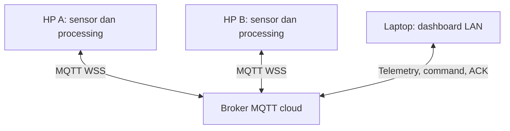

# SigHeat — Peta kualitas koneksi

**SigHeat (Signal Heatmap)** adalah proyek IoT kelompok untuk membandingkan koneksi pada titik pengamatan: **dua HP sebagai edge**, **accelerometer + gyroscope**, **RMS dan integrasi rotasi**, **MQTT cloud**, serta **dashboard di laptop**. Kedua HP dapat memakai browser tanpa instalasi tambahan atau Termux + Python pada Android.

SigHeat mengukur waktu perjalanan pesan aplikasi **HP → broker → HP**, variasi latency, dan keberhasilan probe. Hasilnya bukan kekuatan radio dBm, ping ICMP, atau kecepatan unduh. Lokasi opsional membantu menempatkan pengamatan pada peta.

## Anggota Kelompok

1. [Addia Fa'adihilah Mahendra Nugraha] — [24060125120006]
2. [Farrel Athaya Firdaus] — [24060125120009]
3. [Masirotuzzaman Fatwa Gemintang] — [24060125120001]

## Cara kerja



Setiap HP membaca dua sensor, menghitung hasil dalam window, dan melakukan probe ke broker. Dashboard menerima telemetri serta mengirim **Ukur sekarang** atau **Ubah interval** ke HP terpilih. HP membalas ACK; hasil pengukuran diperiksa pada telemetri berikutnya.

MQTT adalah protokol; HiveMQ/EMQX adalah broker; JSON adalah format payload. ID perangkat harus berbeda, sedangkan ID proyek dan alamat broker harus sama.

## 1. Laptop — buka dashboard

Ekstrak folder proyek. Untuk dashboard lokal, gunakan **Python 3.10+** di laptop; tidak perlu memasang dependensi Python untuk server ini.

```bash
python server.py --port 8000
```

Buka **http://localhost:8000/dashboard.html**. Klik **Hubungkan**, lalu isi:

- **Project ID:** nama unik kelompok, misalnya `sigheat_kelompok_07_uji1`.
- **Broker WSS:** misalnya `wss://broker.hivemq.com:8884/mqtt` untuk latihan publik.
- **Username/password:** hanya jika broker kelompok memerlukannya.

Dashboard **tidak membaca `.env` secara otomatis**. Samakan isian UI dengan kedua HP. Pada broker publik, gunakan lokasi uji nonpribadi; ID proyek adalah pemisah topic, bukan password.

Untuk demo sesuai PDF, laptop dan kedua HP berada pada **Wi-Fi/hotspot yang sama dan terhubung internet**. Halaman dashboard dapat dibuka melalui `http://IP-LAPTOP:8000/dashboard.html` dari perangkat pada LAN. HP pengukur Opsi A tetap memerlukan halaman **HTTPS**.

## 2. HP A dan HP B — pilih salah satu cara

Gunakan opsi yang sama pada kedua HP untuk percobaan awal. Kedua opsi memakai dashboard dan protokol v2 yang sama.

### Opsi A: Browser HP (tanpa Termux)

1. Terbitkan **isi folder proyek** ke hosting HTTPS, misalnya GitHub Pages. `index.html` harus berada di root, dengan folder `assets/` lengkap dan `.nojekyll`.
2. Buka halaman `index.html` melalui HTTPS di dua HP. Setelah upload/deployment repository kelompok berhasil, alamatnya adalah **https://faadd.github.io/SigHeat/**. ZIP revisi tidak otomatis mengubah situs tersebut.
3. Isi ID `hp-a` pada HP A dan `hp-b` pada HP B. Isi Project ID, broker, dan kredensial yang sama dengan dashboard.
4. Pilih pembagian lokasi sebelum mulai jika ingin memetakan titik. Lokasi tidak diperlukan untuk menampilkan hasil pada tabel.
5. Tekan **Mulai pengukuran** dan berikan izin gerakan/orientasi serta lokasi jika dipilih. Tunggu data accelerometer dan gyroscope tersedia.
6. Biarkan halaman terlihat dan layar aktif. Saat tab tersembunyi, sesi dijeda; setelah kembali, tekan mulai lagi.

Tidak perlu memasang aplikasi, Python, PWA, atau ekstensi pada HP. Jika gyroscope tidak tersedia, jangan menggantinya dengan angka nol; gunakan HP/browser yang mendukung atau Opsi B.

**[Panduan browser dan hosting HTTPS →](docs/BROWSER_EDGE.md)**

### Opsi B: Termux + Python pada 2 HP Android

Pasang Termux dan Termux:API dari sumber resmi yang sama. Salin proyek ke kedua HP, lalu jalankan di folder proyek:

```bash
pkg update
pkg install python termux-api
pip install -r requirements.txt
cp .env.example .env
```

Isi `.env` pada masing-masing HP:

```dotenv
PROJECT_ID=sigheat_kelompok_07_uji1
MQTT_WSS_URL=wss://broker.hivemq.com:8884/mqtt
MQTT_USERNAME=
MQTT_PASSWORD=
INTERVAL_S=5
```

Periksa kedua sensor terlebih dahulu:

```bash
python termux_edge.py --check-sensors
```

**HP A:**

```bash
python termux_edge.py hp-a
```

**HP B:**

```bash
python termux_edge.py hp-b
```

Tambahkan `--share-location` bila ingin mengirim lokasi yang diizinkan. Jalankan pada **dua HP fisik**, bukan dua terminal laptop. Termux membaca sensor Android nyata; simulator tidak digunakan sebagai pengganti otomatis.

**[Panduan Termux dan izin Android →](docs/ANDROID.md)**

## 3. Coba sistemnya

1. Pastikan dashboard menampilkan dua ID, sumber `browser` atau `termux`, waktu terbaru, dan kedua sensor tersedia.
2. Diamkan HP B, lalu gerakkan dan putar HP A. Periksa perubahan RMS dan total rotasi.
3. Tempatkan HP pada dua titik, gunakan interval dan durasi yang sama, kemudian tukar posisinya untuk membandingkan hasil.
4. Kirim **Ukur sekarang** atau perubahan interval ke satu HP. Periksa ACK dan telemetri sesudahnya.
5. Uji koneksi terputus; untuk browser, uji tab tersembunyi. Data lama tidak boleh dianggap real-time.
6. Ekspor data dan isi [lembar pengujian](docs/RUBRIC_AND_DEMO.md). Mode contoh selalu berlabel simulasi dan tidak menjadi hasil lapangan.

Sumber browser dan Termux dapat berada dalam satu proyek, tetapi untuk perbandingan kualitas gunakan sumber, broker, dan prosedur yang sebanding. Penjadwalan browser dan runtime Python dapat memengaruhi latency. Dua titik juga belum membuktikan kondisi seluruh wilayah.

## Pelajari kodenya

| Berkas | Fungsi |
|---|---|
| `index.html`, `assets/edge.js` | Edge browser, izin sensor, probe, dan command |
| `termux_edge.py` | Edge Android melalui Termux:API dan MQTT WSS |
| `assets/core.js` | Validasi protokol, kategori, dan agregasi lokasi |
| `dashboard.html`, `assets/app.js` | Pemantauan, kontrol, peta/tabel, ekspor |
| `server.py` | Server dashboard lokal opsional |

Dokumentasi: [Protokol dan algoritma](docs/PROTOCOL.md) · [Rubrik/demo](docs/RUBRIC_AND_DEMO.md) · [Validasi](docs/VALIDATION.md) · [Brief PPT](docs/PRESENTATION_BRIEF.md) · [Perubahan](docs/CHANGELOG.md).

Data hardware dan broker kelompok tetap perlu diuji. Catat sensor yang gagal, timeout, serta akurasi lokasi; jangan menggantinya dengan hasil buatan. Unggah kode ke GitHub, masukkan link dalam PPT, dan sertakan video demo sesuai tugas.

Struktur panduan diadaptasi dari **README PocketGuard yang diberikan pengguna**, dengan isi tetap mengikuti ide SigHeat dan PDF tugas. Fitur anti-pencurian, alarm PocketGuard, dan Sensor Playground umum tidak menjadi fitur SigHeat. Keunikan ide terhadap kelompok lain perlu diperiksa pada sheet kelas.
