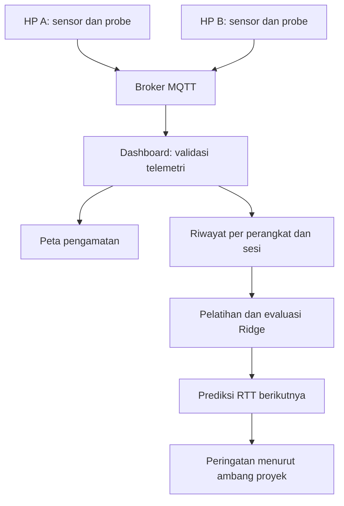

# SigHeat: prediksi RTT MQTT dengan machine learning

## Keputusan ide

Ide ketiga paling sesuai untuk kondisi SigHeat saat ini: **memprediksi RTT pesan MQTT pada pengukuran berikutnya menggunakan regresi yang dilatih dari data**. Pengembangan yang dipilih adalah prediksi RTT ditambah pemberitahuan ketika hasil prediksi melewati ambang proyek. Pemberitahuan tersebut merupakan aturan yang membaca keluaran model; bukan model deteksi anomali tambahan.

Alasannya sederhana: SigHeat sudah menghasilkan urutan pengukuran RTT. Nilai pada pengukuran berikutnya dapat menjadi target belajar tanpa anggota kelompok memberi label satu per satu. Fitur ini menambahkan kemampuan melihat ke depan pada dashboard yang sebelumnya hanya menampilkan hasil pengukuran.

| Ide | Kecocokan | Pertimbangan untuk SigHeat |
|---|---|---|
| 1. Klasifikasi zona sinyal | Dapat dikembangkan kemudian | Kategori kualitas saat ini berasal dari ambang RTT dan keberhasilan probe. Jika kategori yang sama dijadikan label, model hanya belajar meniru aturan itu. Belum ada label kualitas independen dalam berkas yang diberikan. |
| 2. Deteksi anomali jaringan/perangkat | Berguna sebagai tahap berikutnya | Memerlukan contoh kondisi normal yang cukup mewakili penggunaan, cara menilai alarm palsu, serta pemisahan perubahan broker, runtime, perangkat, dan jaringan. Tidak setiap lonjakan RTT berarti anomali jaringan. |
| 3. Prediksi tren latensi | Paling sesuai untuk versi ini | Target numerik tersedia dari pengukuran berikutnya. Hasil dapat diuji dengan MAE/RMSE dan dibandingkan dengan baseline sederhana. Tidak membutuhkan label kualitas buatan. |

Pilihan ini tidak berarti forecasting selalu lebih akurat daripada metode lain. Kesesuaiannya berasal dari tujuan aplikasi dan data yang sudah tersedia. Manfaat nyata tetap harus dibuktikan pada pengukuran kelompok.

## Batas arti pengukuran

RTT yang digunakan adalah waktu perjalanan pesan aplikasi **HP → broker MQTT → HP** dalam milidetik. Nilainya mencakup jalur jaringan, broker, runtime aplikasi, dan penjadwalan perangkat. Apabila broker melewati tunnel, jalur tunnel juga ikut terukur.

RTT ini tidak sama dengan kekuatan radio dalam dBm, ping ICMP, kecepatan unduh, atau luas cakupan Wi-Fi. Karena itu aplikasi tidak menyimpulkan bahwa suatu koordinat pasti merupakan “dead zone”. Peta tetap menggambarkan pengamatan yang benar-benar diterima; prediksi ditampilkan terpisah agar tidak terlihat sebagai hasil ukur lokasi.

## Hubungan dengan materi AI for Everyone

Materi menjelaskan supervised learning sebagai pemetaan input A menjadi output B. Pada proyek ini pemetaannya jelas:

| Komponen | Penerapan |
|---|---|
| Input A | Enam RTT terakhir, ringkasan riwayat, statistik koneksi, dan konteks sensor pada waktu prediksi |
| Output B | RTT aktual pada sampel berikutnya yang berurutan dan memiliki probe berhasil |
| Data training | Pasangan riwayat masa lalu dan hasil pengukuran sesudahnya |
| Model | Regresi Ridge dengan bobot yang dipelajari dari data |
| Inferensi | Menggunakan bobot tersebut untuk menghitung perkiraan RTT berikutnya |
| Evaluasi | MAE dan RMSE pada bagian data test yang tidak digunakan untuk melatih atau memilih parameter |

Kaitannya dengan halaman materi: supervised learning dan A → B pada halaman 15 dan 26; pemilihan fitur/target pada halaman 29–31; pengumpulan data dari perilaku mesin pada halaman 35; data salah dan hilang pada halaman 38–39; train, validation, test serta keterbatasan ML pada halaman 45. Sistem ini termasuk AI dengan tugas khusus, bukan AGI, chatbot, atau model bahasa.

## Arsitektur dan alur kerja

Fungsi IoT asli tetap berjalan. Dua HP membaca accelerometer dan gyroscope, menghitung RMS serta integrasi rotasi, melakukan probe, lalu mengirim telemetri melalui MQTT. Dashboard menerima telemetri, memvalidasi isinya, dan menampilkannya pada panel serta peta. Perintah dari dashboard ke HP dan balasan ACK tetap menggunakan protokol yang sama.

Tambahan ML berjalan lokal di browser dashboard. Tidak ada panggilan ke API AI berbayar dan tidak perlu memasang pustaka ML Python. Implementasi JavaScript yang sama dapat dijalankan melalui Node.js untuk pelatihan ulang dari CSV dan pengujian otomatis.

Data dari HP A dan HP B tidak dicampur menjadi satu deret waktu. Setiap model hanya berlaku untuk satu konteks yang sesuai dengan data latihnya.

## Dataset dan target

Satu baris dataset adalah satu telemetri. Identitas konteks mencakup `project_id`, `device_id`, `boot_id`, `source`, `broker_endpoint`, `interval_s`, dan `accel_mode`. Pergantian salah satu identitas ini memerlukan kelompok data atau model yang berbeda. Hal ini mencegah satu deret menyambungkan dua perangkat, dua sesi, atau dua konfigurasi pengukuran yang tidak sebanding. Model versi ini terikat pada sesi boot: memulai ulang edge memerlukan pengumpulan data dan pelatihan baru, meskipun HP yang digunakan tetap sama. Ekspor JSON tersedia untuk pemeriksaan dan penggunaan melalui kode; dashboard belum menyediakan impor model.

Untuk memprediksi sampel pada waktu t+1, model memakai enam pengukuran sampai waktu t. Labelnya adalah `latency_ms` pada sampel t+1. Target tidak memakai `latency_mean_ms`, sebab rerata berjalan dapat memuat nilai yang sama dengan riwayat input dan membuat tugas terlihat lebih mudah.

Urutan harus masuk akal: nomor `sequence` berurutan, waktu meningkat, dan selisih waktu berada dalam batas 0,5 sampai 2,5 kali interval konfigurasi. Celah urutan, pengukuran terlalu berdekatan, atau jeda panjang memutus jendela. Menekan perintah “Ukur sekarang” selama perekaman dapat membuat jarak sampel berubah; jendela yang tidak sesuai akan dikeluarkan.

Jika `probe_ok=false`, RTT tidak diketahui dan bernilai `null`. Timeout tidak diganti dengan nol, 5.000 ms, atau angka lain. Model regresi ini mempelajari besarnya RTT ketika probe berhasil; model ini **tidak memprediksi probabilitas timeout**. Jendela yang memerlukan RTT gagal tidak dipakai sehingga prediksi menunggu riwayat valid kembali. Akibat penyaringan ini, periode yang sering mengalami kegagalan koneksi kurang terwakili pada evaluasi regresi. MAE rendah pada probe berhasil tidak membuktikan kemampuan menghadapi outage.

Sensor yang tidak tersedia diberi penanda ketersediaan tersendiri. Nilai pengisi untuk fitur sensor tidak boleh dibaca sebagai bukti bahwa HP benar-benar diam. Perbedaan mode accelerometer juga dipisahkan dalam identitas konteks.

Urutan 16 fitur pada implementasi adalah sebagai berikut. Enam lag disusun dari yang terbaru menuju yang terlama; fitur lain memakai enam nilai tersebut atau baris terbaru saja.

| Fitur | Perhitungan dan arti |
|---|---|
| `rtt_lag_0` sampai `rtt_lag_5` | Enam RTT terakhir, dalam ms |
| `rtt_mean_6` | Rerata enam RTT, dalam ms |
| `rtt_std_6` | Simpangan baku populasi enam RTT, dalam ms |
| `rtt_slope_6` | (RTT terbaru − RTT terlama) / 5, dalam ms per langkah sampel |
| `success_pct` | Persentase keberhasilan pada telemetri terbaru |
| `latency_std_ms` | Statistik variasi RTT yang dikirim perangkat pada telemetri terbaru |
| `accel_rms` | RMS percepatan terbaru, dalam m/s² |
| `gyro_rms_rad_s` | RMS kecepatan putar terbaru, dalam rad/s |
| `accel_missing`, `gyro_missing`, `jitter_missing` | 1 jika nilai terkait hilang, 0 jika tersedia |

Nilai sensor atau statistik variasi yang hilang diisi 0 pada vektor fitur, bersamaan dengan penanda kehilangan bernilai 1. RTT dalam jendela tidak memakai pengisian seperti ini: seluruhnya harus benar-benar tersedia.

## Cara model belajar

Ridge adalah regresi linear dengan penalti terhadap besarnya koefisien. Secara ringkas, model mencari bobot w dan intersep b yang membuat hasil prediksi mendekati RTT aktual:

`prediksi = b + w1 × fitur1 + w2 × fitur2 + ... + wp × fiturp`

Tujuan pelatihannya:

`min Σ(y_i - (b + z_i · w))² + alpha × Σ(w_j²)`

Di sini `z` adalah fitur yang distandardisasi menggunakan rerata dan skala dari data training. Intersep tidak dikenai penalti. Penalti membantu menahan koefisien yang terlalu besar ketika beberapa fitur saling berkaitan, misalnya RTT terakhir dan rerata RTT.

Bobot tidak ditulis manual untuk menghasilkan angka yang tampak masuk akal. Bobot dihitung dari pasangan input dan target training. Inilah bagian machine learning-nya. Sebaliknya, rata-rata bergerak biasa hanya mengikuti rumus tetap sehingga digunakan sebagai pembanding, bukan disebut sebagai model ML terlatih.

Model diuji dengan kandidat `alpha` 0,1; 1; 10; dan 100. Kandidat dipilih dari MAE validation. Koefisien final tetap merupakan hasil pelatihan pada bagian training; implementasi tidak melatih ulang memakai test.

## Pembagian waktu dan pencegahan kebocoran data

Dataset harus sudah berurutan sesuai waktu pengamatan; duplikat dan urutan mundur ditolak. Data dibagi menurut baris mentah: 60% awal untuk training, 20% berikutnya untuk validation, dan 20% terakhir untuk test. Pengacakan antarbaris tidak digunakan.

Jendela enam baris input dan satu target hanya dibentuk apabila seluruh baris eksplisit tersebut berada dalam bagian yang sama. Enam baris awal setiap bagian diperlukan sebagai riwayat sehingga tidak semuanya menjadi target. Konsekuensinya, jumlah pasangan belajar lebih kecil daripada jumlah baris mentah. Kegagalan probe dan celah waktu dapat mengurangi jumlahnya lagi.

`latency_std_ms` dan `success_pct` telah dihitung edge dari riwayat probe. Ringkasan tersebut dapat mencakup pengamatan terdahulu sebelum batas bagian, sebagaimana tersedia ketika forecasting dijalankan. Ini bukan pemakaian nilai masa depan, tetapi berarti tidak tepat menyatakan bahwa semua pengamatan mentah pembentuk seluruh statistik antarbagian sepenuhnya terpisah.

| Bagian | Penggunaan yang diizinkan |
|---|---|
| Training | Menghitung normalisasi fitur dan melatih koefisien model |
| Validation | Memilih alpha serta memilih model atau baseline yang akan digunakan |
| Test | Mengukur hasil akhir setelah pilihan tersebut ditetapkan |

Nilai dari masa depan tidak boleh menentukan skala training. Hasil test juga tidak boleh dipakai untuk mengganti alpha lalu tetap disebut sebagai hasil test independen. Jika kelompok berulang kali memperbaiki model berdasarkan dataset yang sama, sediakan sesi pengukuran baru sebagai pengujian akhir.

Batas 120 baris merupakan batas teknis awal, bukan bukti bahwa data sudah mewakili jaringan. Pada data lengkap tanpa celah, 120 baris menghasilkan 66 pasangan training, 18 validation, dan 18 test. Pelatihan juga mensyaratkan sedikitnya 24 pasangan training dan masing-masing 8 pasangan validation/test setelah penyaringan. Pada interval target 5 detik, 120 baris memerlukan sekitar 10 menit apabila berjalan lancar. Sebaiknya kumpulkan 300–1.000 baris per konteks, kemudian ulangi eksperimen pada sesi lain untuk menilai kestabilan hasil.

## Membaca hasil evaluasi

Model dibandingkan dengan dua baseline pada pasangan test yang sama:

1. **Persistence:** perkiraan berikutnya sama dengan RTT terakhir.
2. **Rata-rata bergerak:** perkiraan berikutnya sama dengan rerata enam RTT terakhir.

MAE adalah rata-rata besar kesalahan absolut. RMSE adalah akar rerata kuadrat kesalahan; kesalahan besar memiliki pengaruh lebih kuat. Keduanya memakai satuan ms dan nilai lebih kecil lebih baik.

`MAE = mean(abs(y_aktual - y_prediksi))`

`RMSE = sqrt(mean((y_aktual - y_prediksi)²))`

Sebagai ilustrasi perhitungan, kesalahan 10, 20, dan 30 ms menghasilkan MAE 20 ms. Angka ilustrasi ini bukan hasil pengujian SigHeat. MAE tidak dapat diubah begitu saja menjadi “akurasi 95%”.

Ridge dipilih sebagai prediktor aktif apabila MAE validation setidaknya 5% lebih rendah daripada baseline terbaik. Jika belum memenuhi syarat, sistem memilih baseline terbaik dan menunjukkan bahwa ML belum memberi peningkatan yang cukup. Ambang 5% adalah kebijakan proyek untuk memilih metode, bukan uji signifikansi statistik.

Tabel test tetap menampilkan ketiga metode. Metode yang unggul pada validation dapat kalah pada test; hal itu perlu dilaporkan sebagai hasil percobaan, bukan disembunyikan. Pengujian sintetis hanya memeriksa bahwa pipeline pelatihan dan evaluasi bekerja pada pola buatan.

## Inferensi dan peringatan dini

Setelah tersedia model yang cocok dan enam RTT terakhir yang valid, dashboard menyusun fitur dengan urutan yang sama seperti saat training. Fitur distandardisasi memakai parameter training, dikalikan koefisien, lalu menghasilkan perkiraan dalam ms. Hasil Ridge dibatasi pada 0–60.000 ms agar tetap sesuai rentang numerik protokol; pembatasan ini tidak menjamin akurasi pada kondisi ekstrem. Aplikasi tidak mengeluarkan probabilitas atau interval kepercayaan yang belum dikalibrasi.

Horizon berarti **sampel telemetri berikutnya**, dengan interval target sesuai konfigurasi perangkat. Interval 5 detik tidak berarti prediksi selalu tepat untuk waktu t+5,000 detik: durasi probe, runtime, jaringan, dan perintah manual dapat mengubah waktu pengiriman.

Peringatan muncul bila perkiraan melewati 500 ms, mengikuti ambang proyek untuk RTT tinggi. Peringatan ini berarti “perkiraan respons aplikasi lambat”; tidak berarti penyebabnya sudah diketahui. Tampilan membedakan hasil ukur terakhir, hasil prediksi Ridge, baseline, dan metode yang dipilih.

Saat data belum cukup, koneksi terputus, pengamatan terlalu lama, konteks berubah, atau jendela terbaru tidak valid, aplikasi menampilkan alasan tanpa mengarang angka prediksi. Model dari demo sintetis tidak digunakan untuk mengklaim prediksi pengukuran nyata.

## Yang sudah tersedia dan yang perlu dibuktikan kelompok

Paket menyediakan kode model, pelatihan lokal, evaluasi kronologis, contoh data sintetis yang dapat diulang, integrasi dashboard, ekspor data/model, serta pengujian otomatis. Pengujian otomatis dan demo tidak menggantikan uji dua HP fisik.

Tidak ada rekaman RTT lapangan untuk melatih model jaringan kelompok di dalam ZIP sumber yang diberikan. Karena itu paket tidak menyatakan tingkat akurasi jaringan nyata. Kualitas prediksi baru dapat dinilai setelah kelompok mengumpulkan data, melatih model pada data tersebut, dan memeriksa test serta sesi baru.

Hubungan gerakan dengan RTT merupakan pola statistik yang mungkin dipelajari, bukan bukti bahwa gerakan menyebabkan gangguan. Broker lambat, tab browser tertunda, perpindahan jaringan, atau beban HP dapat mengubah RTT tanpa perubahan kekuatan radio. Prediksi tidak boleh dipakai untuk mengubah firewall, antrean router, atau konektivitas secara otomatis.

## Panduan berkas

| Berkas | Fungsi |
|---|---|
| `assets/ml.js` | Pembentukan fitur, pelatihan Ridge, evaluasi, validasi model, dan inferensi |
| `assets/ml-ui.js` | Panel ML dan alur data di dashboard |
| `scripts/train-ml.cjs` | Pelatihan dari CSV melalui Node.js |
| `scripts/generate-ml-demo.cjs` | Membuat ulang data demo dengan seed tetap |
| `data/` | Contoh dataset berlabel sintetis |
| `models/` | Model dan laporan evaluasi contoh |
| `tests/test_ml.cjs` | Pengujian model dan penanganan data |
| `docs/AI_DEMO_DAN_PENGUJIAN.md` | Langkah demo, pengujian, dan protokol lapangan |
| `docs/DATASET_CARD.md` | Skema, asal, penggunaan, dan keterbatasan dataset |

## Acuan

1. Materi pengguna, *AI for Everyone 1.pptx(1).pdf*, khususnya halaman 15, 26, 29–31, 35, 38–39, dan 45.
2. Materi pengguna, *Praktek Multicommunication 2 Arah dan Multisensorss LAST(1).pdf*, halaman 14–15 tentang ketentuan dan komponen penilaian.
3. Dokumentasi scikit-learn, [Ridge](https://scikit-learn.org/stable/modules/generated/sklearn.linear_model.Ridge.html), sebagai acuan formulasi regularisasi. Implementasi SigHeat memakai JavaScript sendiri, bukan memanggil scikit-learn.
4. Dokumentasi scikit-learn, [Lagged features for time series forecasting](https://scikit-learn.org/stable/auto_examples/applications/plot_time_series_lagged_features.html), sebagai acuan fitur historis dan evaluasi yang menghormati urutan waktu.

Kode sumber awal yang digunakan adalah ZIP SigHeat yang dilampirkan. Perubahan paket ini belum dipublikasikan ke repository GitHub kelompok.
