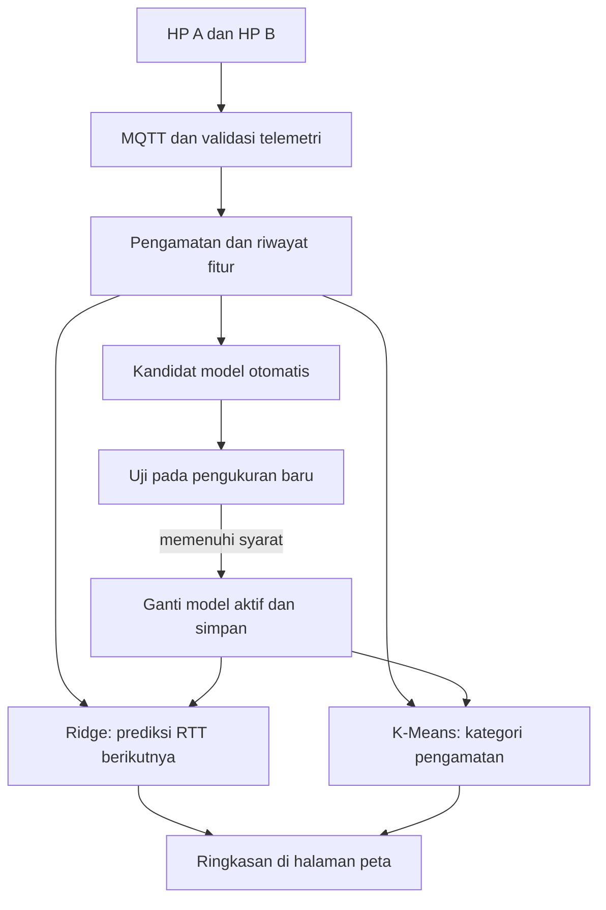

# SigHeat 4.0: ML otomatis untuk RTT dan kategori koneksi

## Perubahan yang diminta kelompok

Versi 4.0 menerapkan dua kebutuhan yang berbeda: pengguna tidak lagi diminta menekan tombol training, dan kategori koneksi di dashboard tidak lagi diputuskan oleh batas RTT 150/500 ms. Pengembangan mengikuti percakapan kelompok: model awal disiapkan sebelumnya, hasil langsung berada di halaman peta, dan pengalaman penggunaan dapat dipakai untuk memperbarui model.

Solusinya menggabungkan **Ridge Regression untuk memprediksi RTT berikutnya** dan **K-Means untuk mengelompokkan profil koneksi tanpa label manual**. Keduanya berjalan lokal di browser dashboard. Pengukuran, dua sensor pada HP, RMS, integrasi rotasi, MQTT, serta command/ACK tetap berjalan seperti sebelumnya.

| Kebutuhan | Implementasi versi 4.0 |
|---|---|
| Tidak ada tab training terpisah | Prediksi, kategori ML, dan status pembelajaran ditampilkan bersama pengamatan perangkat pada halaman utama |
| Memakai hasil training bawaan | Parameter model yang sudah dilatih dimuat otomatis; membuka halaman tidak melatih ulang model bawaan |
| Belajar dari penggunaan berikutnya | Data nyata yang valid membentuk kandidat model secara otomatis di belakang layar |
| Pengalaman tidak hilang saat refresh | Model dan riwayat fitur terbatas disimpan pada browser yang sama |
| Mengganti threshold kualitas | Warna/kategori dashboard berasal dari centroid K-Means, bukan cabang aturan RTT 150/500 ms |
| Memeriksa apakah pembaruan bermanfaat | Kandidat dibandingkan dengan model aktif pada pengukuran baru sebelum dipromosikan |

Tidak tersedia histori pengukuran nyata dalam arsip sumber kelompok. Oleh karena itu **model bawaan paket ini dilatih dari data sintetis dan diberi label demikian**. Ia menyediakan titik awal yang bisa dijalankan, bukan bukti bahwa model sudah cocok untuk jaringan kelompok. Penyesuaian dari pengukuran nyata harus dievaluasi selama penggunaan.

## Mengapa dua model?

Prediksi dan pengelompokan menjawab pertanyaan berbeda. Regresi memperkirakan angka pada masa depan. Clustering menjelaskan kelompok pola pengamatan saat ini. Menambahkan regresi saja tidak mengganti keputusan warna peta jika warna masih memakai threshold lama.

| Ide awal | Keputusan pada versi ini |
|---|---|
| Klasifikasi zona otomatis | Tidak melatih model memakai label yang berasal dari threshold lama. Sebagai gantinya, K-Means mempelajari tiga kelompok profil koneksi dari data tanpa label |
| Deteksi anomali | Belum diklaim sebagai kemampuan yang tervalidasi. Kelompok beban tinggi bukan bukti anomali atau penyebab gangguan |
| Prediksi tren latensi | Tetap dipakai sebagai regresi supervised untuk RTT pengukuran berikutnya |

K-Means merupakan **unsupervised learning**, yang juga bagian dari machine learning. Ridge tetap **supervised learning** meskipun training berjalan otomatis dan tidak ada orang yang memberi label satu per satu. Label regresi diperoleh ketika pengukuran berikutnya benar-benar datang.

## Apa yang sebenarnya diukur?

SigHeat mengukur waktu perjalanan pesan aplikasi **HP → broker MQTT → HP**, dalam milidetik. RTT mencakup jaringan, broker, tunnel bila digunakan, runtime, dan penjadwalan HP. Nilai ini bukan kekuatan sinyal dBm, ping ICMP, throughput, atau ukuran cakupan radio.

Nama kategori baru adalah **beban relatif rendah, sedang, dan tinggi**. Relatif berarti terhadap pola yang dipelajari model, bukan standar mutu jaringan universal. Jika seluruh data berasal dari jaringan lambat, cluster terendah tetap dapat memiliki RTT yang lambat dalam arti praktis. Sebutan “dead zone” tidak dapat disimpulkan hanya dari model ini.

Warna peta mengklasifikasikan **pengamatan yang telah diterima**. Angka prediksi ditempatkan sebagai perkiraan berikutnya, bukan diperlakukan sebagai pengukuran pada sebuah koordinat.

## Alur sistem

Dua HP tetap mengirim telemetri menggunakan protokol v2. Dashboard memeriksa identitas, tipe data, rentang, urutan, dan broker sebelum memberikan pengamatan kepada modul pembelajaran.

Parameter bawaan dimuat terlebih dahulu. Setelah enam RTT terbaru yang valid tersedia, regresi dapat menghasilkan perkiraan tanpa menunggu training manual atau pengumpulan 120 baris. Pengumpulan yang lebih panjang diperlukan untuk **menyesuaikan model dari data nyata**, bukan untuk membuka fitur pertama kali.

## Model 1: supervised Ridge Regression

Untuk memprediksi sampel t+1, input hanya menggunakan informasi yang tersedia sampai t. Targetnya adalah RTT mentah `latency_ms` pada sampel berikutnya yang langsung berurutan dan berhasil, bukan rerata RTT berjalan.

| Input | Perhitungan |
|---|---|
| Enam lag RTT | `rtt_lag_0` sampai `rtt_lag_5`, dari terbaru ke terlama |
| Rerata dan variasi | Rerata serta simpangan baku enam RTT |
| Perubahan RTT | (RTT terbaru - RTT terlama) / 5 |
| Statistik koneksi terbaru | `success_pct` dan `latency_std_ms` |
| Konteks gerakan | `accel_rms` dan `gyro_rms_rad_s` |
| Penanda nilai hilang | `accel_missing`, `gyro_missing`, `jitter_missing` |

Total terdapat 16 fitur. Sensor yang tidak tersedia diwakili pengisi nol **beserta penanda hilang**; pengisi itu bukan pengukuran bahwa HP diam. RTT yang gagal tidak diisi nol: jendela regresi memerlukan enam RTT valid dan berurutan.

Ridge mempelajari koefisien yang meminimalkan kesalahan kuadrat ditambah penalti besarnya koefisien:

`prediksi = b + z · w`

`min sum((y - prediksi)^2) + alpha × sum(w^2)`

`z` adalah fitur yang distandardisasi menggunakan parameter training. Penalti membantu menahan koefisien besar ketika fitur saling berkaitan. Bobot dihitung dari data, tidak ditulis manual untuk menghasilkan angka tertentu. Nilai `alpha` dipilih dari kandidat 0,1; 1; 10; dan 100 melalui validasi kronologis.

Dua pembanding tetap disediakan: **persistence** memakai RTT terakhir, sedangkan **moving average** memakai rerata enam RTT. Keduanya berguna untuk memeriksa apakah kompleksitas ML memberi manfaat. Sistem dapat memakai baseline apabila bukti pengamatan baru menunjukkan bahwa baseline lebih baik; asal metode harus tetap terlihat.

Galat prediksi dinilai dengan MAE: rerata `abs(RTT aktual - RTT prediksi)` pada target valid yang sama, dalam ms. MAE 20 ms berarti besar kesalahan rata-rata 20 ms pada periode yang dinilai, bukan akurasi 80% atau jaminan semua prediksi berada dalam 20 ms.

## Model 2: unsupervised K-Means

Model kualitas menerima tiga fitur pengamatan lengkap:

| Fitur model | Transformasi |
|---|---|
| RTT terakhir | `log(1 + latency_ms) / log(60001)` |
| Variasi RTT | `log(1 + latency_std_ms) / log(60001)` |
| Proporsi probe gagal | `(100 - success_pct) / 100` |

Transformasi tetap dipakai oleh model lama dan kandidat agar jaraknya dapat dibandingkan pada skala yang sama. Transformasi ini bukan batas untuk memberi label baik/buruk. Posisi batas keputusan ditentukan oleh **centroid yang dipelajari**.

K-Means membagi data menjadi tiga kelompok dengan mengulang dua operasi: menempatkan setiap titik pada centroid terdekat, lalu menghitung ulang centroid dari anggota kelompok tersebut. Implementasi memakai beberapa inisialisasi deterministik agar hasil dapat diulang. Saat inferensi, cluster dipilih berdasarkan jarak kuadrat terdekat.

Centroid diurutkan menurut jumlah ketiga komponen untuk memberi nama **beban relatif rendah/sedang/tinggi**. Urutan itu adalah konvensi interpretasi: angka RTT, variasi, dan proporsi gagal yang lebih tinggi dibaca sebagai beban lebih tinggi. Tidak ada label training yang berasal dari threshold RTT 150/500 ms.

Fit memerlukan sedikitnya 60 profil lengkap, sekurangnya tiga titik berbeda, dan kelompok yang cukup terisi serta terpisah. Kandidat dengan cluster kosong, kolaps, atau terlalu kecil ditolak. Jitter yang hilang atau probe timeout menghasilkan status belum dapat diklasifikasikan, bukan angka nol atau cluster rekaan.

K-Means tidak menghasilkan “akurasi 95%” tanpa label kualitas eksternal. Galat kuantisasi yang lebih kecil berarti centroid lebih dekat dengan profil data dalam metrik ini; hal itu belum membuktikan bahwa kategori lebih sesuai dengan pengalaman pengguna atau bahwa gangguan jaringan telah ditemukan.

## Kapan dan bagaimana model belajar otomatis?

Pengukuran baru mula-mula dipakai untuk menyelesaikan prediksi yang telah dibuat sebelumnya. Dengan demikian, target tidak diketahui ketika prediksi dibuat. Setelah syarat data terpenuhi, dashboard menjadwalkan pemeliharaan model di belakang layar. Pembaruan berupa pelatihan ulang berkala dari buffer riwayat terbaru yang terbatas, bukan perubahan bobot pada setiap sampel. Proses dijalankan oleh JavaScript di browser dashboard; tidak memerlukan server AI atau API berbayar. Penjadwalan menunda komputasi pada event loop halaman, bukan menjalankannya pada Web Worker terpisah.

| Tahap | Regresi RTT | Kategori K-Means |
|---|---|---|
| Mulai dari bawaan | Parameter Ridge sintetis | Centroid sintetis |
| Usulan kandidat pertama | Sedikitnya 120 baris pada konteks yang sesuai, dengan pasangan valid yang cukup | Sedikitnya 90 baris konteks; fit tetap memerlukan 60 profil lengkap |
| Jarak antar-usulan | Paling cepat setelah 60 baris baru | Paling cepat setelah 60 baris baru |
| Pembandingan | Kandidat, model aktif, dan dua baseline pada 24 target baru yang valid | Kandidat dan model aktif pada 24 profil baru yang lengkap |
| Syarat pergantian | MAE kandidat minimal 5% lebih rendah daripada model aktif dan kedua baseline | Rerata jarak kuadrat kandidat minimal 5% lebih rendah daripada model aktif |

Angka minimum dan margin 5% adalah kebijakan teknis pemilihan model, bukan threshold mutu koneksi dan bukan uji signifikansi statistik. Data dengan gap atau timeout dapat membuat waktu tunggu lebih panjang. Banyaknya demo tidak menjamin kandidat akan diterima; mempertahankan model lama adalah hasil yang wajar bila pembaruan belum terbukti membantu.

Kandidat dibekukan sebelum pengamatan pembanding datang. Set pengukuran pembanding ini dipakai untuk keputusan promosi, sehingga bukan “test akhir independen” yang boleh digunakan berulang-ulang untuk mengklaim performa keseluruhan. Untuk laporan akademik, rekam periode baru setelah keputusan model dibekukan sebagai evaluasi akhir tambahan.

Regresi kandidat dibangun memakai pembagian kronologis internal 60% training, 20% validation, dan 20% test diagnostik. Enam baris input eksplisit dan target tidak melintasi batas bagian, boot, atau celah urutan. Normalisasi hanya dihitung dari training. Statistik `success_pct` dan `latency_std_ms` yang sudah dibuat edge dapat membawa informasi pengamatan terdahulu, tetapi tidak boleh memakai data masa depan.

## Penyimpanan lintas sesi

Model prediksi dipisahkan menurut proyek, perangkat, sumber Browser/Termux, broker, interval, dan mode accelerometer. Identitas `boot_id` tetap ada pada setiap sampel, tetapi tidak lagi menjadi identitas model yang disimpan. Model dapat dipakai pada boot baru yang cocok; riwayat enam RTT tetap harus dibentuk ulang tanpa menyambungkan dua boot.

Model K-Means dipakai bersama oleh perangkat pada proyek, sumber, broker, dan interval yang sama. Ini membantu kedua HP menggunakan batas kategori yang sama. Ketika model berubah, titik yang terlihat diklasifikasikan ulang dengan classifier aktif. Bila konteks classifier berbeda, kategori relatif tidak boleh dibandingkan seolah memakai standar yang identik.

Penyimpanan berada pada browser dan origin yang sama, misalnya `http://localhost:8000`. Mengganti browser, perangkat, hostname, port, atau protokol dapat menggunakan tempat penyimpanan berbeda. Tidak ada sinkronisasi otomatis antarlaptop. Cadangan JSON dapat dipakai untuk memindahkan pembelajaran yang sesuai.

Data disimpan secara terbatas: paling banyak 12 konteks regresi dan 12 konteks clustering, masing-masing hingga 1.200 baris terbaru. Konteks yang paling dahulu dibuat dapat tersisih jika kapasitas tercapai. Yang disimpan adalah fitur dan metadata pengukuran, bukan koordinat GPS atau password broker. Jika penyimpanan ditolak browser, penuh, atau rusak, aplikasi tetap dapat bekerja di memori dan menampilkan keterbatasannya. Dataset yang dipulihkan tidak dihitung sebagai telemetri baru atau bukti promosi baru.

Model kandidat dapat dipulihkan, tetapi akumulasi penilaiannya dimulai ulang setelah refresh agar riwayat tersimpan tidak dijadikan bukti baru yang belum diverifikasi. Data demo sintetis terpisah dan tidak memperbarui model pengukuran nyata.

## Model kelompok sebagai bawaan demo

Model awal sintetis dapat dibuat ulang secara deterministik: Ridge memakai 960 telemetri sintetis, sedangkan K-Means memakai 480 profil sintetis. Keduanya memakai seed 240601. Pelatihan dilakukan oleh script build; browser memuat koefisien dan centroid, bukan melakukan fit bawaan setiap halaman dibuka.

Untuk memakai hasil pengukuran kelompok sebagai bawaan, kumpulkan telemetri nyata sebelum presentasi dan biarkan evaluasi serta promosi otomatis berjalan. Unduh cadangan pembelajaran, lalu jalankan `node scripts/build-learning-seed.cjs --input sigheat-pembelajaran.json`. Builder memvalidasi state dan memerlukan sedikitnya satu model aktif hasil pengukuran. Hasilnya, `assets/learning-seed.js`, dapat dikemas bersama situs. Paket awal menyertakan seed kosong karena belum ada model lapangan kelompok.

Pada browser baru, seed tersebut dimuat otomatis. Cadangan lokal valid lebih diprioritaskan agar pembelajaran pengguna yang lebih baru tetap dipakai. Model hanya berlaku untuk konteks yang cocok; perubahan broker, proyek, interval, perangkat regresi, atau mode sensor dapat memerlukan konteks baru. Pengguna tetap perlu mengirim pengukuran baru: snapshot tersimpan bukan data live, dan inferensi tidak menyambungkan window lintas boot.

Langkah persiapan ini dilakukan kelompok sebelum demo, tanpa menambahkan tombol training pada alur pengguna. Ia memungkinkan penjelasan yang tepat: ada hasil belajar awal yang disiapkan kelompok, lalu data penggunaan berikutnya dapat memperbaruinya bila pembaruan memenuhi pemeriksaan.

## Apa yang berubah dari threshold lama?

Warna titik, kategori perangkat, ringkasan, dan grid dashboard memakai hasil clustering. `connection_quality` yang dihitung oleh protokol lama dapat tetap ada sebagai kompatibilitas format; dashboard baru mengabaikannya untuk keputusan kategori. Label lama “Responsif <= 150 ms” dan “Cukup <= 500 ms” tidak dipakai sebagai legenda model.

Grid merangkum kelas yang paling sering muncul di antara sampel dalam sel; seri menghasilkan status tidak terklasifikasi. Jumlah anggota tiap kelas dan identitas model dapat diperiksa. Grid gabungan dinonaktifkan bila proyek, sumber, broker, atau interval pada tampilan membentuk beberapa konteks model. Ringkasan lokasi ini bukan prediksi cakupan radio di area yang belum diukur.

Pemeriksaan validitas angka, timeout, kedaluwarsa data, minimum jumlah sampel, dan syarat promosi tetap memakai batas operasional. Mengganti kategori mutu dengan ML tidak berarti semua batas keselamatan dan konsistensi data harus dihapus.

## Kesesuaian dengan materi dan cara menjelaskan

Materi *AI for Everyone* menjelaskan supervised learning sebagai pemetaan A ke B. Di sini A adalah riwayat RTT dan konteks, sedangkan B adalah RTT aktual berikutnya. Data diperoleh dari perilaku mesin; kualitas data, nilai hilang, pembagian training/validation/test, dan batas kemampuan model tetap diperhatikan. K-Means menambahkan contoh unsupervised learning karena ia mencari kelompok profil tanpa label kategori manual.

Pernyataan lisan yang sesuai: “SigHeat memuat model awal secara otomatis. Ridge memperkirakan RTT berikutnya, sedangkan K-Means mempelajari kategori beban relatif yang menggantikan batas RTT tetap. Pengukuran baru dipakai untuk menguji dan memperbarui model; pembaruan hanya dipakai jika memenuhi syarat.”

Jelaskan juga asal model awal: paket belum berisi training dari jaringan kelompok. Model sintetis disertakan untuk menyediakan implementasi yang dapat dijalankan dan diuji. Pengamatan nyata, hasil menang/kalah terhadap baseline, serta batas generalisasi harus dilaporkan terpisah.

## Batas dan pekerjaan lapangan

Ridge tidak memprediksi probabilitas timeout. Penyaringan jendela berhasil membuat periode outage kurang terwakili pada metrik regresi. Hubungan gerakan HP dan RTT bukan bukti bahwa gerakan menyebabkan koneksi buruk. K-Means tidak mengenali penyebab gangguan, dan kategori relatif bukan jaminan layanan.

Model bawaan dibuat pada pola sintetis; pemakaiannya pada interval atau mode sensor yang berbeda bersifat eksperimental sampai ada bukti adaptasi dari data nyata. Model yang diterima pada satu periode juga dapat memburuk ketika jaringan berubah. Pantau metrik dan ulangi evaluasi pada periode baru. Prediksi tidak mengubah firewall, antrean router, atau konfigurasi jaringan secara otomatis.

Uji perangkat lunak tidak menggantikan uji dua HP fisik, izin sensor browser, broker kelompok, dan tampilan pada layar yang dipakai presentasi. Hasil pemeriksaan aktual paket dicatat di `docs/RELEASE_VALIDATION.md`; prosedur lapangan tersedia di `docs/AI_DEMO_DAN_PENGUJIAN.md`.

## Acuan

1. Materi pengguna, *AI for Everyone 1.pptx(1).pdf*: supervised learning dan A ke B pada halaman 15 dan 26; fitur/target pada 29-31; perilaku mesin pada 35; nilai salah/hilang pada 38-39; evaluasi dan keterbatasan pada 45.
2. Materi pengguna, *Praktek Multicommunication 2 Arah dan Multisensorss LAST(1).pdf*, halaman 14-15 tentang ketentuan dan penilaian tugas.
3. Dokumentasi scikit-learn, [Ridge](https://scikit-learn.org/stable/modules/generated/sklearn.linear_model.Ridge.html), sebagai acuan formulasi regresi berregularisasi. Implementasi SigHeat memakai JavaScript sendiri.
4. Google Machine Learning, [What is k-means clustering?](https://developers.google.com/machine-learning/clustering/kmeans/overview), sebagai acuan pengelompokan berdasarkan centroid.
5. Dokumentasi scikit-learn, [Lagged features for time series forecasting](https://scikit-learn.org/stable/auto_examples/applications/plot_time_series_lagged_features.html), sebagai acuan evaluasi yang menghormati waktu.

Kode awal berasal dari ZIP pengguna dan pengembangan SigHeat versi 3.0 pada percakapan ini. Paket versi 4.0 belum dipublikasikan ke repository GitHub kelompok.
