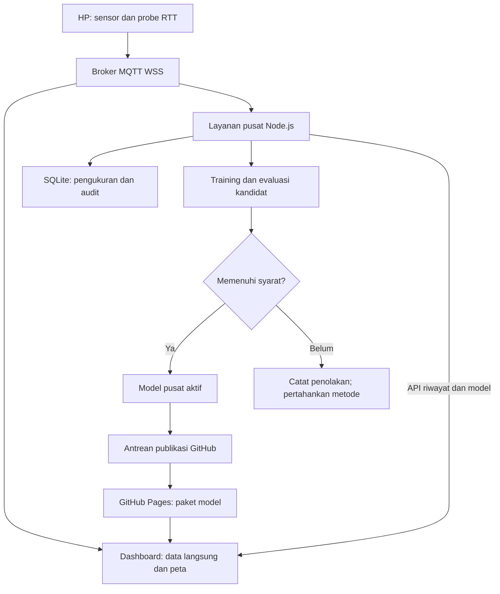

# Arsitektur dan penjelasan ML SigHeat v5

Dokumen ini menjelaskan jalur **layanan pusat**. Mode pembelajaran lokal versi 4 tetap merupakan jalur terpisah. Untuk mulai menjalankan proyek, baca [Mulai di sini](MULAI_DI_SINI_V5.md).

## 1. Masalah yang diselesaikan

Pada versi 4, dashboard melakukan training di browser dan menyimpan hasilnya pada penyimpanan browser tersebut. Model hasil belajar laptop A tidak otomatis tersedia pada laptop B. Menutup seluruh dashboard juga menghentikan pengumpulan dan training di dashboard.

Versi 5 menambahkan **satu layanan pusat**. Layanan ini menerima telemetri dari broker, menyimpan data ke SQLite, melatih kandidat, mencatat evaluasi, dan menentukan model yang digunakan. Dashboard menampilkan hasil serta mengambil parameter pusat yang cocok dengan konteks perangkatnya.

Kemampuan belajar tidak lagi bergantung pada Chrome tertentu. Syaratnya, dashboard menggunakan layanan pusat atau paket model terbitan yang sama. Mode lokal lama masih mempunyai penyimpanan masing-masing.

## 2. Komponen dan aliran data



| Komponen | Tugas | Harus tetap berjalan agar data baru masuk? |
|---|---|---|
| HP pengukur | Membaca sensor, melakukan probe, mengirim telemetri | Ya, untuk data dari HP itu |
| Broker MQTT | Meneruskan pesan edge dan dashboard/pusat | Ya |
| Layanan pusat | Mencatat data, training, evaluasi, publikasi | Ya |
| SQLite | Menyimpan data dan status yang dapat dilanjutkan | Diakses layanan pusat |
| Dashboard | Menampilkan peta, prediksi, riwayat, dan grafik | Tidak, untuk pengumpulan pusat |
| GitHub Pages | Menyajikan berkas website dan parameter model | Bukan tempat menjalankan listener MQTT atau training |

Ada dua jalur berbeda menuju dashboard: MQTT untuk pengamatan langsung serta API/manifest untuk model dan bukti evaluasi. Halaman yang berhasil dibuka belum berarti broker maupun pusat sudah terhubung. Periksa ketiga status tersebut.

## 3. Sensor, lokasi, dan makna RTT

Accelerometer memberikan informasi perubahan gerak. Gyroscope memberikan laju rotasi. Edge merangkum sensor dalam jendela pengamatan, antara lain RMS dan statistik rotasi, lalu mengirim ringkasan tersebut. Nilai yang tidak tersedia tetap ditandai sebagai hilang; tidak diganti menjadi pengukuran nol.

Lokasi bersifat opsional. Koordinat yang diizinkan pengguna dipakai untuk menempatkan titik dan membentuk heatmap. Lokasi bukan syarat untuk training RTT dan tidak masuk paket parameter model publik.

RTT SigHeat adalah waktu perjalanan pesan aplikasi **HP → broker → HP yang sama**. Satuannya milidetik. RTT ini mencakup jalur jaringan, broker, transport WebSocket, dan penjadwalan aplikasi. Ia tidak mengukur langsung komunikasi antar-HP, RSSI/RSRP, daya radio dalam dBm, atau kecepatan unduh.

Jika broker dijalankan di laptop melalui tunnel, jalur tunnel dan laptop ikut memengaruhi hasil. Gunakan broker, interval, sumber pengukuran, dan prosedur yang sebanding ketika membandingkan lokasi.

## 4. Identitas dan konteks

Topic telemetri tetap menggunakan:

```text
sigheat/{project}/edge/{device_id}/telemetry
```

Setiap HP menggunakan `device_id` berbeda. `project_id`, broker, dan interval disamakan untuk percobaan yang ingin dibandingkan. `boot_id` membedakan sesi perangkat; `sequence` membedakan urutan pesan dalam sesi.

Model Ridge dipisahkan menurut proyek, perangkat, sumber Browser/Termux, broker, interval, dan mode accelerometer. Model K-Means dipakai bersama pada proyek, sumber, broker, dan interval yang sama. Jadi, tiga HP dapat berbagi K-Means tanpa mencampur riwayat enam RTT milik tiap HP untuk Ridge.

Layanan memeriksa pesan sebelum menerima data untuk pembelajaran. Pesan duplikat tidak boleh menambah hitungan. Waktu pengukuran dan waktu penerimaan disimpan terpisah. Data lama, celah urutan, reboot, timeout, serta konteks yang berubah memengaruhi apakah suatu pasangan layak dievaluasi.

Project ID memisahkan topic; ia bukan autentikasi. Broker publik dapat menerima pesan dari pihak lain. Untuk penggunaan dengan data sensitif, gunakan broker dengan autentikasi dan ACL yang sesuai.

## 5. Ridge: supervised learning tanpa label manual

Enam RTT sebelumnya menjadi input. RTT aktual tepat berikutnya menjadi target. Target diambil dari pengukuran yang benar-benar terjadi, bukan dari prediksi model sendiri.

| Input | Target |
|---|---|
| RTT 1–6 | RTT 7 |
| RTT 2–7 | RTT 8 |
| RTT 3–8 | RTT 9 |

Enam nilai lag dilengkapi mean, simpangan baku, kemiringan tren, tingkat keberhasilan probe, variasi RTT, accelerometer, gyroscope, dan indikator nilai hilang. Urutan 16 fitur dipertahankan agar parameter dan engine inferensi cocok.

Ridge mencari bobot dan intercept dengan penalti yang membatasi besarnya bobot. Input distandardisasi dengan parameter yang dihitung dari bagian training. Nilai `alpha` dipilih dari 0,1; 1; 10; dan 100 berdasarkan validasi kronologis.

```text
z_j = (fitur_j - center_j) / scale_j
prediksi = intercept + jumlah(coefficients_j × z_j)
```

Pembagian historis adalah 60% training, 20% validation, dan 20% test diagnostik. Jendela input-target tidak melintasi batas bagian, reboot, atau celah urutan. Akibatnya, jumlah pasangan yang benar-benar dipakai dapat lebih kecil daripada jumlah baris mentah.

**Training** menghasilkan parameter. **Inferensi** memakai parameter untuk membuat prediksi. **Evaluasi** membandingkan prediksi yang sudah tercatat dengan target aktual yang baru tiba. Ketiganya mempunyai waktu dan bukti yang berbeda.

## 6. K-Means: kelompok koneksi relatif

K-Means mempelajari pusat kelompok dari fitur RTT, variasi RTT, dan proporsi kegagalan dalam ruang transformasi yang tetap. Tidak diperlukan label manual “baik/sedang/buruk”. Nama **beban relatif rendah/sedang/tinggi** diberikan untuk membantu membaca kelompok yang terbentuk.

Kategori ini menggantikan pemisahan statis RTT 150/500 ms. Ia bersifat relatif terhadap model dan data pada konteksnya. Kelompok tinggi tidak memastikan penyebab gangguan; kelompok rendah juga bukan sertifikasi mutu jaringan.

Evaluasi K-Means memakai **rata-rata jarak kuadrat ke centroid terdekat**, pada profil yang sama untuk kandidat dan model aktif. Angka ini bukan MAE RTT, bukan persen akurasi berlabel, dan tidak membuktikan bahwa setiap titik sudah diberi kategori yang benar secara eksternal.

## 7. Jadwal otomatis dan keputusan kandidat

| Kebijakan awal | Ridge | K-Means |
|---|---|---|
| Mulai mencoba training | Sedikitnya 120 baris per konteks dan pasangan valid yang cukup | Sedikitnya 90 baris; fit memerlukan sedikitnya 60 profil lengkap |
| Percobaan berikutnya | Sedikitnya 60 baris baru dan tidak ada kandidat menunggu evaluasi | Sama |
| Evaluasi kandidat | 24 target baru yang valid | 24 profil baru yang lengkap |
| Metrik | MAE, milidetik | Rata-rata jarak kuadrat pada ruang fitur |
| Syarat promosi | Sedikitnya 5% lebih baik dari pembanding terbaik | Sedikitnya 5% lebih baik dari model aktif |

Kandidat dibekukan sebelum evaluasi berikutnya. Tidak ada pembaruan bobot diam-diam selama 24 target itu dinilai. Semua pembanding memakai target yang sama.

```text
best = min(MAE aktif, MAE RTT terakhir, MAE rata-rata enam RTT)
lolos Ridge = MAE kandidat < best DAN MAE kandidat <= 0.95 × best

lolos K-Means = error kandidat < error aktif
               DAN error kandidat <= 0.95 × error aktif
```

Syarat ketat `<` mencegah kandidat dengan galat nol dianggap lebih baik daripada acuan yang juga nol. Persen perbaikan tidak dihitung dengan pembagian nol. Margin 5% adalah perubahan relatif terhadap galat pembanding, bukan “MAE harus kurang dari 5%”.

Jika baseline lebih sesuai, sistem dapat memilih **RTT terakhir** atau **rata-rata enam RTT** sebagai metode prediksi. Metode tersebut tetap diberi nama baseline; tidak disebut Ridge. Model Ridge yang tersimpan dan metode yang sedang dipakai harus dibaca sebagai dua informasi berbeda.

Pada interval 5 detik, 120 pesan tanpa gangguan kira-kira membutuhkan 10 menit. Ini perkiraan jumlah pesan, bukan janji waktu model diterima. Timeout, jeda, pasangan tidak lengkap, serta evaluasi 24 target sesudah training menambah waktu yang dibutuhkan.

## 8. Bukti yang disimpan dan cara membaca grafik

Prediksi resmi disimpan **sebelum target aktual datang**. Model baru tidak digunakan untuk menggambar ulang masa lalu seolah-olah sudah membuat prediksi pada waktu itu. Model awal sintetis dibekukan sebagai pembanding yang tidak ikut berubah saat adaptasi.

Semua grafik berada di **Rincian pembelajaran & cadangan**, di halaman peta yang sama.

| Bukti | Pertanyaan yang dijawab |
|---|---|
| RTT aktual dan prediksi | Seberapa jauh prediksi yang dibuat saat itu dari RTT berikutnya? |
| MAE per blok 24 target valid | Bagaimana kinerja sistem berubah pada blok target yang tidak bertumpang tindih? |
| Evaluasi tiap kandidat | Mengapa model diterima atau ditolak pada 24 target promosi tersebut? |
| Riwayat versi dan metode | Model/metode mana yang dipakai, kapan berubah, dan kapan dipublikasikan? |
| Evaluasi K-Means dan anggota kelompok | Bagaimana jarak profil ke pusat kelompok dan pembagian anggotanya? |

MAE dihitung sebagai rata-rata `abs(prediksi - RTT aktual)`. MAE 12 ms berarti rata-rata selisih absolut 12 ms pada target yang dinilai, bukan akurasi 88%. Nilai yang lebih kecil lebih baik pada **target dan kondisi perbandingan yang sama**.

Grafik dapat naik, turun, atau mendatar. Jika satu blok memuat beberapa versi model/metode, angka blok tersebut menggambarkan sistem adaptif campuran. Ia tidak boleh diklaim sebagai kinerja satu model terakhir.

Timeout atau prediksi yang tidak layak dipasangkan menghasilkan celah atau status pengecualian, bukan error nol. Hitungan target valid perlu dibaca bersama jumlah pengukuran gagal dan jeda.

Evaluasi 24 target untuk promosi merupakan proses pemilihan model. Untuk laporan penelitian, lakukan periode pengujian tambahan setelah model dibekukan. Jangan menyebut hasil pemilihan itu sebagai pengujian akhir independen.

## 9. Model pusat, publikasi, dan cache

Ada tiga tahap yang tidak selalu selesai bersamaan:

1. **Aktif di pusat:** keputusan model/metode sudah berlaku untuk prediksi pusat berikutnya.
2. **Tersimpan di GitHub:** antrean publikasi berhasil membuat commit paket model.
3. **Tersedia di Pages dan tersinkron ke dashboard:** workflow deployment selesai, lalu dashboard berhasil mengambil manifest dan artefak.

Dashboard memeriksa pembaruan berkala; interval awalnya 60 detik. Manifest menunjuk artefak berversi dengan checksum. Dashboard memeriksa format, fitur, angka, konteks, dan integritas sebelum mengganti paket secara utuh. Jika pembaruan gagal, salinan valid terakhir dapat tetap digunakan dengan status kegagalan/kedaluwarsa yang terlihat.

Pada pembukaan baru di Pages, mode pusat memeriksa manifest website yang sama. Paket awal hanya berisi bootstrap sintetis sampai parameter hasil pengukuran diterbitkan. URL API pusat harus diatur untuk mengakses grafik/arsip bersama. Mode training lokal tersedia hanya sebagai pilihan lama yang diaktifkan pengguna secara eksplisit.

Checksum membantu mendeteksi berkas berubah atau rusak. Kepercayaan terhadap asal berkas tetap memerlukan alamat yang benar dan HTTPS pada akses terbit.

Hanya parameter serta metadata yang diperlukan yang boleh masuk paket publik. Database, data pengukuran mentah, GPS, cadangan lokal, dan token publikasi tidak menjadi aset website. Token GitHub hanya berada pada lingkungan layanan pusat, tidak dimasukkan ke JavaScript browser.

## 10. Ketika perangkat atau tab ditutup

| Keadaan | Perilaku yang dapat diharapkan |
|---|---|
| Dashboard ditutup, pusat/broker/HP masih aktif | Pengumpulan dan training pusat tetap berjalan |
| Laptop dashboard dimatikan; pusat berada pada mesin lain | Pusat tetap bekerja untuk edge yang masih aktif |
| Laptop yang menjalankan pusat dimatikan | Pusat berhenti; data/model yang sudah tersimpan tetap ada |
| HP benar-benar dimatikan | HP tersebut tidak dapat mengukur atau mengirim data |
| Tab pengukur browser ditutup | JavaScript pengukur berhenti; tidak dapat dijanjikan tetap online |
| Layar HP mati atau aplikasi masuk latar belakang | Bergantung batas OS; browser tidak dijadikan pengukur latar belakang yang dijamin |
| Koneksi kembali | Perangkat dapat menyambung kembali sesuai mekanisme edge; gap tetap dicatat sebagai gap |

Untuk pengukuran Android yang tidak bergantung pada tab browser, gunakan jalur Termux yang dijelaskan di [Ketersediaan perangkat](AVAILABILITY.md). Tetap perlukan HP menyala, internet, izin sensor, dan proses yang tidak dihentikan Android. Wake lock dan layanan otomatis tidak dapat membuat HP yang mati tetap mengirim.

Pesan telemetri tidak di-retain sebagai arsip oleh protokol ini. Data yang tidak diterima ketika pusat/broker mati tidak direkonstruksi sebagai pengukuran nyata.
